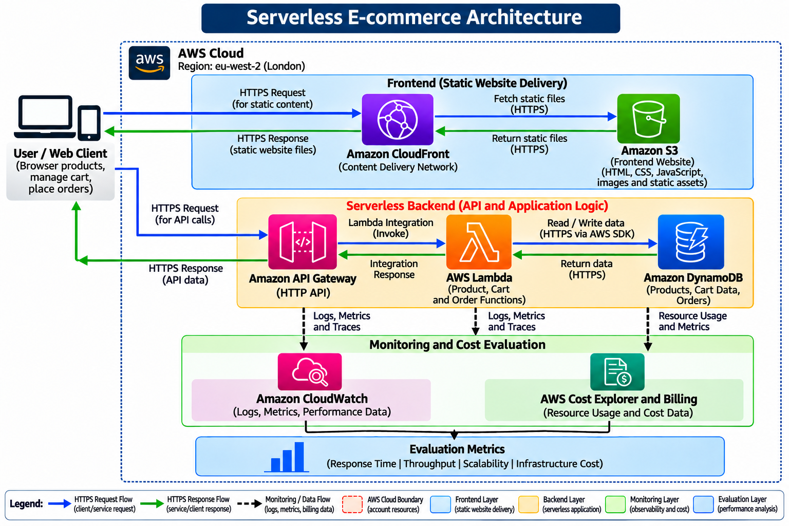
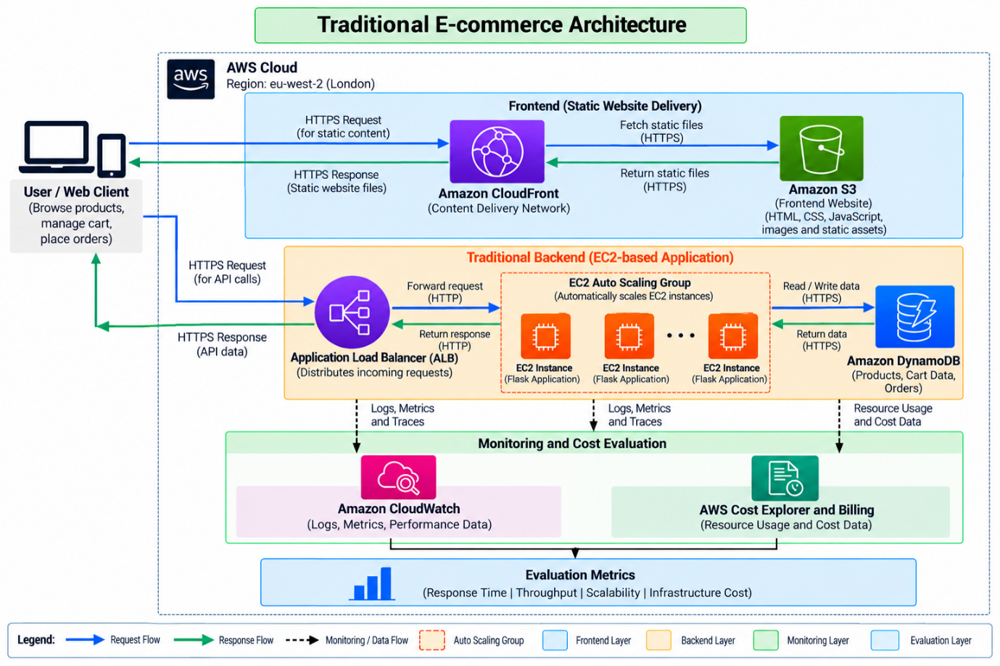

# MSc E-Commerce Cloud Architecture — Terraform Implementation and Performance Evaluation

## 1. Project Overview

This repository contains the Infrastructure as Code (IaC), application source code, workload testing scripts, architecture diagrams and experimental evidence developed for the MSc Computer Science dissertation at York St John University.

**Dissertation Title:**

*Design and Performance Evaluation of a Serverless Cloud-Based Architecture for Reducing Infrastructure Cost and Improving Scalability During Peak Traffic in E-Commerce Applications.*

The project investigates the performance, scalability, reliability and infrastructure cost of two AWS cloud architectures supporting an e-commerce application:

- Serverless cloud architecture using Amazon API Gateway and AWS Lambda.
- Traditional server-based cloud architecture using Amazon EC2, Application Load Balancer and Auto Scaling.

Both architectures were provisioned using Terraform and evaluated using simulated e-commerce workloads generated by Locust.

The experimental evaluation was conducted in the AWS Europe (London) region (`eu-west-2`).

## Table of Contents

- [1. Project Overview](#1-project-overview)
- [2. Project Objectives](#2-project-objectives)
- [3. System Architecture](#3-system-architecture)
- [4. Infrastructure Deployment](#4-infrastructure-deployment)
- [5. Experimental Setup and Workload Testing](#5-experimental-setup-and-workload-testing)
- [6. Experimental Results](#6-experimental-results)
- [7. Scalability and Reliability](#7-scalability-and-reliability)
- [8. Infrastructure Cost Evaluation](#8-infrastructure-cost-evaluation)
- [9. Experimental Limitations](#9-experimental-limitations)
- [10. Experimental Evidence](#10-experimental-evidence)
- [11. Infrastructure Cleanup and Repository Security](#11-infrastructure-cleanup-and-repository-security)
- [12. Key Findings](#12-key-findings)
- [13. Academic Context](#13-academic-context)

## 2. Project Objectives

The principal objectives of this project are to:

- Design and implement a serverless cloud-based architecture for an e-commerce application.
- Implement a traditional EC2-based architecture as a comparative baseline.
- Provision both architectures using Terraform to support infrastructure consistency and reproducibility.
- Evaluate application performance under simulated peak-traffic conditions.
- Compare response time, throughput, scalability, reliability and infrastructure cost.
- Investigate the suitability of serverless computing for handling variable e-commerce workloads.
- Maintain experimental evidence to support the findings presented in the dissertation.

## 3. System Architecture

### 3.1 Serverless Architecture

The serverless architecture uses managed AWS services to execute application functionality without requiring the provisioning or management of dedicated application servers.



The principal AWS services are:

| AWS Service | Purpose |
|---|---|
| Amazon CloudFront | Content delivery and frontend distribution |
| Amazon S3 | Static frontend hosting and object storage |
| Amazon API Gateway | HTTP API endpoint management |
| AWS Lambda | Serverless execution of application business logic |
| Amazon DynamoDB | NoSQL storage for products, carts and orders |
| AWS IAM | Access control and service permissions |
| Amazon CloudWatch | Monitoring, logging and performance metrics |

The application backend consists of Lambda functions responsible for product retrieval, shopping cart management and order processing.

AWS Lambda automatically manages the underlying compute infrastructure and adjusts execution capacity in response to incoming requests, subject to applicable service quotas.

### 3.2 Traditional Server-Based Architecture

The traditional architecture uses Amazon EC2 instances to host a Python Flask application behind an Application Load Balancer.



The principal AWS services are:

| AWS Service | Purpose |
|---|---|
| Amazon CloudFront | Content delivery and frontend distribution |
| Amazon S3 | Static frontend hosting and object storage |
| Application Load Balancer | Distribution of incoming application requests |
| Amazon EC2 | Hosting the Flask application |
| Amazon EC2 Auto Scaling | Dynamic adjustment of application instance capacity |
| Amazon VPC | Network isolation and connectivity |
| Amazon DynamoDB | NoSQL storage for products, carts and orders |
| AWS IAM | Access control and service permissions |
| Amazon CloudWatch | Monitoring, logging and performance metrics |

The Flask application implements the same principal e-commerce operations exposed by the serverless architecture.

The Auto Scaling Group adjusts EC2 capacity according to its configured scaling policy.

### 3.3 Application Functionality

Both architectures support the following e-commerce API operations:

| HTTP Method | Endpoint | Functionality |
|---|---|---|
| GET | `/products` | Retrieve available products |
| POST | `/cart` | Add a product to a shopping cart |
| GET | `/cart/{id}` | Retrieve shopping cart information |
| POST | `/orders` | Create a customer order |

Amazon DynamoDB provides the database technology for both architectures.

Although both implementations expose equivalent application functionality, differences in their internal execution paths are acknowledged as an experimental limitation.

### 3.4 Technology Stack

| Technology | Purpose |
|---|---|
| Amazon Web Services | Cloud infrastructure platform |
| Terraform | Infrastructure as Code |
| Python | Backend application development |
| Flask | Traditional application framework |
| AWS Lambda | Serverless application execution |
| HTML, CSS and JavaScript | Frontend application |
| Locust | Performance and workload testing |
| Amazon CloudWatch | Infrastructure monitoring and metrics |
| AWS Cost Explorer | Infrastructure cost evaluation |
| Git and GitHub | Version control and project documentation |

### 3.5 Repository Structure

The repository is organised as follows. The structure is simplified to exclude individual experimental evidence files and generated local files.

```text
msc-ecommerce-terraform/
├── README.md
├── .gitignore
├── .terraform.lock.hcl
├── backend.tf
├── api_gateway.tf
├── cloudfront.tf
├── dynamodb.tf
├── ec2_autoscaling.tf
├── ec2_baseline.tf
├── frontend_hosting.tf
├── iam.tf
├── main.tf
├── networking.tf
├── outputs.tf
├── providers.tf
├── s3.tf
├── serverless.tf
├── variables.tf
├── versions.tf
├── terraform.tfvars.example
├── bootstrap/
│   ├── .terraform.lock.hcl
│   ├── main.tf
│   ├── outputs.tf
│   ├── providers.tf
│   └── versions.tf
├── docs/
│   └── architecture/
│       ├── serverless-architecture.png
│       └── traditional-architecture.png
├── ec2/
│   └── user_data.sh
├── experimental-evidence/
│   ├── README.md
│   ├── aws-cost-explorer/
│   ├── Serverless-400-users-2026-10-16/
│   ├── serverless-200-users-2026-10-18/
│   ├── traditional-400-users-2026-10-16/
│   └── traditional-200-users-2026-10-18/
├── frontend/
│   ├── index.html
│   └── images/
├── lambda/
│   ├── get_products/
│   ├── cart/
│   └── order/
└── load-testing/
    ├── locustfile.py
    └── evidence/
```

| Directory or File | Description |
|---|---|
| `bootstrap/` | Independent Terraform configuration for provisioning the remote state backend |
| `backend.tf` | S3 remote state and native state-locking configuration |
| `*.tf` | Terraform infrastructure configuration files |
| `.terraform.lock.hcl` | Terraform provider dependency lock file |
| `terraform.tfvars.example` | Example infrastructure variable configuration |
| `docs/architecture/` | Architecture diagrams |
| `ec2/` | EC2 application initialisation configuration |
| `lambda/` | Serverless application source code and deployment packages |
| `frontend/` | Static e-commerce frontend |
| `load-testing/` | Locust workload testing scripts and supporting evidence |
| `experimental-evidence/` | Experimental results, monitoring evidence and cost records |
| `.gitignore` | Exclusion rules for sensitive and generated local files |

## 4. Infrastructure Deployment

### 4.1 Prerequisites

The following tools and resources are required:

- AWS account with appropriate IAM permissions
- AWS CLI
- Terraform v1.11 or later with generally available native S3 state-locking support, subject to the project's configured version constraints
- Git
- Python
- Locust

AWS credentials must be configured securely outside the repository.

The following software versions were recorded in the development environment during repository documentation and maintenance in November 2026:

| Component | Version |
|---|---|
| Terraform | 1.17.1 |
| HashiCorp AWS provider | 6.67.0 |
| HashiCorp Archive provider | 2.8.1 |
| Python | 3.14.6 |
| Locust | 2.46.6 |

These versions describe the current development environment and are not presented as independently verified versions used during the original October experiments.

Terraform native S3 state locking was introduced in v1.10 and became generally available in v1.11.

Official documentation:

- [Terraform v1.11.0 Release Notes](https://github.com/hashicorp/terraform/releases/tag/v1.11.0)
- [Terraform S3 Backend Documentation](https://developer.hashicorp.com/terraform/language/backend/s3)
- [Terraform AWS Provider Registry](https://registry.terraform.io/providers/hashicorp/aws/latest/docs)

### 4.2 Clone the Repository

Clone the repository using its GitHub clone URL and navigate into the project directory.

```bash
cd msc-ecommerce-terraform
```

### 4.3 Configure AWS Credentials

Configure AWS CLI credentials using:

```bash
aws configure
```

Verify the configured AWS identity:

```bash
aws sts get-caller-identity
```

The experimental infrastructure was deployed in the AWS Europe (London) region:

```bash
export AWS_DEFAULT_REGION=eu-west-2
```

AWS credentials and access keys must not be committed to the repository.

### 4.4 Configure Terraform Remote State

The project uses Amazon S3 for remote Terraform state storage and native S3 state locking.

The remote backend was introduced during post-experimental repository maintenance in November 2026 to improve infrastructure state management and reproducibility.

The backend configuration is maintained in `backend.tf`:

```hcl
terraform {
  backend "s3" {
    bucket       = "obiom-msc-ecommerce-terraform-state"
    key          = "ecommerce/terraform.tfstate"
    region       = "eu-west-2"
    encrypt      = true
    use_lockfile = true
  }
}
```

The backend provides:

- Remote Terraform state storage.
- Server-side encryption of state data.
- Native S3 state locking to prevent conflicting Terraform operations.
- Separation of state management infrastructure from application infrastructure.

Native S3 state locking removes the requirement for a separate DynamoDB state-locking table.

The configured bucket name belongs to the original project. Anyone reproducing the infrastructure in a separate AWS account must select a globally unique S3 bucket name and update the bootstrap and backend configurations consistently.

### 4.5 Provision the Remote State Backend

The S3 backend must exist before Terraform initialises the main infrastructure configuration.

The independent `bootstrap/` directory provisions the required backend infrastructure.

From the project root, execute:

```bash
cd bootstrap
terraform init
terraform fmt -check
terraform validate
terraform plan -out=bootstrap.tfplan
terraform apply bootstrap.tfplan
terraform output
cd ..
```

Review the bootstrap configuration and ensure that the resulting S3 bucket name matches the bucket specified in `backend.tf`.

The bootstrap configuration maintains its own Terraform state independently of the main application infrastructure.

The bootstrap state must be retained securely and must not be committed to GitHub.

### 4.6 Initialise the Main Terraform Configuration

For a new deployment, initialise Terraform using:

```bash
terraform init
```

If an existing local Terraform state is being migrated to the configured S3 backend, use:

```bash
terraform init -migrate-state
```

The migration command transfers existing Terraform state to the newly configured backend.

State migration is not required for a fresh deployment without existing local state.

### 4.7 Configure Infrastructure Variables

Create a local variable configuration using the provided example:

```bash
cp terraform.tfvars.example terraform.tfvars
```

Review and update `terraform.tfvars` according to the intended deployment environment.

The local variable file is excluded from version control through `.gitignore`.

### 4.8 Validate and Deploy the Infrastructure

Check Terraform formatting:

```bash
terraform fmt -check -recursive
```

Validate the configuration:

```bash
terraform validate
```

Generate a saved execution plan:

```bash
terraform plan -out=tfplan
```

Review the planned infrastructure changes before deployment:

```bash
terraform show tfplan
```

Apply the saved plan:

```bash
terraform apply tfplan
```

Display the deployed infrastructure outputs:

```bash
terraform output
```

The outputs and deployed AWS resources can be used to identify the frontend distribution, serverless API endpoint and traditional application endpoint.

### 4.9 Verify the Deployment

After deployment:

- Confirm that the application infrastructure has been created successfully.
- Verify that the traditional application targets are healthy.
- Confirm that the serverless API endpoints respond successfully.
- Verify that the frontend application is accessible.
- Test product retrieval, cart management and order creation.
- Review CloudWatch logs and metrics before initiating workload tests.

## 5. Experimental Setup and Workload Testing

### 5.1 Experimental Design

Both architectures were evaluated using two concurrent-user workload levels in the AWS Europe (London) region.

| Workload | Test Date | Configured Duration |
|---|---|---|
| 200 concurrent users | 18 October 2026 | 15 minutes |
| 400 concurrent users | 16 October 2026 | 10 minutes |

Both architectures were tested on the same date at each workload level. However, the two workload levels were evaluated on different dates.

The tests were conducted sequentially rather than simultaneously.

The configured workload durations were consistent between architectures at each workload level.

### 5.2 Locust Workload Configuration

Locust was used to simulate concurrent e-commerce customers interacting with the application API endpoints.

The workload script is available at:

[`load-testing/locustfile.py`](load-testing/locustfile.py)

| Configuration Parameter | 200-User Workload | 400-User Workload |
|---|---|---|
| Concurrent users | 200 | 400 |
| User spawn rate | 5 users/second | 5 users/second |
| Expected ramp-up duration | 40 seconds | 80 seconds |
| Configured test duration | 15 minutes | 10 minutes |
| Wait time between customer journeys | 1–2 seconds | 1–2 seconds |
| HTTP requests per journey | 4 | 4 |
| Product selection | Random | Random |
| Product quantity | 1 | 1 |
| AWS region | eu-west-2 | eu-west-2 |

The spawn rate of five users per second was retrospectively corroborated using the Number of Users charts retained in the final Locust HTML reports.

The configured test durations include the user ramp-up period.

The documented local development machine is an HP EliteBook x360 1040 G8 with an 11th Generation Intel Core i7-1185G7 processor, four physical CPU cores, eight logical processors and 32 GB of RAM.

The exact historical load-generator execution environment was not independently verified during repository documentation.

### 5.3 Simulated Customer Journey

Each simulated user executes a complete e-commerce customer journey consisting of four sequential HTTP requests:

1. Retrieve the available products using `GET /products`.
2. Add a randomly selected product to the shopping cart using `POST /cart`.
3. Retrieve the shopping cart using `GET /cart/{id}`.
4. Create an order using `POST /orders`.

After completing the customer journey, the simulated user waits randomly between one and two seconds before repeating the task.

The wait time is implemented using:

```python
wait_time = between(1, 2)
```

This wait time applies between complete customer journeys rather than between individual HTTP requests.

Unique cart and order identifiers are generated using UUIDs and a test-run identifier to distinguish records created during individual experiments.

### 5.4 Request Distribution

The workload generates an approximately equal distribution across the four HTTP operations.

| HTTP Operation | Requests per Complete Journey |
|---|---:|
| Product retrieval | 1 |
| Cart update | 1 |
| Cart retrieval | 1 |
| Order creation | 1 |

The resulting HTTP request distribution is approximately 1:1:1:1.

The serverless architecture uses a shared Cart Lambda function for cart retrieval and cart updates. Consequently, the expected Lambda invocation distribution across the Products, Cart and Order functions is approximately 1:2:1.

Minor differences in the observed request distribution can occur when tests terminate before all simulated users complete their current customer journeys.

### 5.5 Running Locust

Install Locust in the Python environment:

```bash
python -m pip install locust
```

Navigate to the workload testing directory:

```bash
cd load-testing
```

Start Locust for the serverless 200-user experiment:

```bash
TEST_RUN=SL-200 locust -f locustfile.py
```

For the traditional 200-user experiment:

```bash
TEST_RUN=EC2-200 locust -f locustfile.py
```

For the serverless 400-user experiment:

```bash
TEST_RUN=SL-400 locust -f locustfile.py
```

For the traditional 400-user experiment:

```bash
TEST_RUN=EC2-400 locust -f locustfile.py
```

Access the Locust web interface at:

```text
http://localhost:8089
```

Configure the relevant application endpoint as the target host and enter the workload parameters specified in Section 5.2.

Use the serverless API Gateway endpoint for the serverless experiments and the Application Load Balancer endpoint for the traditional experiments.

Configure the appropriate test duration and allow Locust to terminate the workload automatically.

Export the final HTML report after each experiment.

### 5.6 Monitoring and Data Collection

Experimental data was collected using:

- Locust HTML performance reports.
- Amazon CloudWatch metrics and logs.
- AWS Lambda invocation and execution metrics.
- Amazon EC2 utilisation metrics.
- EC2 Auto Scaling activity records.
- Application Load Balancer metrics.
- AWS Cost Explorer records.

The final Locust HTML reports provide the primary source for the application-level request statistics presented in this repository.

## 6. Experimental Results

### 6.1 Overall Performance Results

The following results were obtained from the final Locust HTML reports.

| Performance Metric | Serverless 200 Users | Traditional 200 Users | Serverless 400 Users | Traditional 400 Users |
|---|---:|---:|---:|---:|
| Total requests | 365,203 | 90,017 | 263,909 | 75,733 |
| Failed requests | 0 | 0 | 0 | 709 |
| Failure rate | 0.00% | 0.00% | 0.00% | 0.94% |
| Mean response time (ms) | 103.84 | 1,578.50 | 410.44 | 2,580.60 |
| Median response time (ms) | 83 | 1,000 | 370 | 1,400 |
| 95th percentile response time (ms) | 210 | 4,800 | 670 | 7,800 |
| 99th percentile response time (ms) | 240 | 7,200 | 770 | 10,000 |
| Average throughput (requests/s) | 405.63 | 99.99 | 439.07 | 126.12 |

Average throughput values are taken from the final Locust reports rather than intermediate live-testing screenshots.

### 6.2 Response Time Analysis

The serverless architecture recorded lower mean response times at both workload levels.

| Workload | Serverless Mean (ms) | Traditional Mean (ms) | Mean Response Time Reduction |
|---|---:|---:|---:|
| 200 users | 103.84 | 1,578.50 | 93.4% |
| 400 users | 410.44 | 2,580.60 | 84.1% |

The serverless architecture also recorded substantially lower median, 95th percentile and 99th percentile response times.

Both architectures experienced increased response times when the concurrent-user workload increased from 200 to 400 users.

However, the serverless architecture maintained lower response times under both evaluated workload conditions.

### 6.3 Throughput Analysis

| Workload | Serverless (Requests/s) | Traditional (Requests/s) | Serverless-to-Traditional Ratio |
|---|---:|---:|---:|
| 200 users | 405.63 | 99.99 | 4.1× |
| 400 users | 439.07 | 126.12 | 3.5× |

The serverless architecture achieved higher average throughput at both workload levels.

When the workload increased from 200 to 400 concurrent users, serverless throughput increased by approximately 8.2%.

Traditional architecture throughput increased by approximately 26.1%.

Although the serverless architecture maintained higher absolute throughput, the relatively limited increase in serverless throughput indicates that additional concurrent users did not produce a proportional increase in completed requests per second.

Potential explanations include increased application response times, load-generator resource constraints and other client-side or infrastructure limitations.

### 6.4 Per-Operation Response Time Analysis

The following table compares mean response times for individual application operations.

| Application Operation | Serverless 200 Users (ms) | Traditional 200 Users (ms) | Serverless 400 Users (ms) | Traditional 400 Users (ms) |
|---|---:|---:|---:|---:|
| Product retrieval | 68.95 | 755.92 | 540.23 | 1,511.24 |
| Cart update | 94.48 | 1,919.62 | 346.83 | 2,931.89 |
| Cart retrieval | 63.19 | 695.32 | 333.85 | 1,483.04 |
| Order creation | 188.74 | 2,950.16 | 420.74 | 4,418.45 |

The serverless implementation recorded lower mean response times across all four application operations at both workload levels.

These results describe the observed implementations and should not be interpreted as establishing that serverless computing is inherently faster than every possible traditional server-based configuration.

## 7. Scalability and Reliability

### 7.1 Serverless Scalability

The serverless architecture used AWS Lambda to manage application execution capacity in response to incoming API requests.

Unlike the traditional architecture, it did not require the explicit provisioning or scaling of application server instances.

The serverless architecture processed both evaluated workloads without recorded HTTP request failures.

Nevertheless, the increase in response time and relatively limited throughput growth at 400 concurrent users indicate that the system was not demonstrated to scale linearly.

### 7.2 Traditional Architecture Scalability

The traditional architecture used an EC2 Auto Scaling Group to adjust application server capacity in response to its configured scaling policy.

EC2 scaling involves additional instance provisioning, application initialisation and load balancer health checks before new instances can contribute to request processing.

These factors can introduce delays between an increase in workload demand and the availability of additional application capacity.

### 7.3 Observed Auto Scaling Activity

EC2 Auto Scaling activity was observed during both workload experiments.

| Workload | Test Date | Reported Scaling Activity |
|---|---|---|
| 200 users | 18 October 2026 | Scale-out from one to three EC2 instances |
| 400 users | 16 October 2026 | Scale-out from one to two EC2 instances |

The scaling observations demonstrate that the traditional architecture responded dynamically to workload demand.

However, the observed scaling activity did not eliminate the performance differences between the two evaluated implementations.

The retained CloudWatch metrics and Auto Scaling activity records provide the supporting infrastructure-level evidence.

### 7.4 Reliability and Request Failures

| Workload | Serverless Failures | Traditional Failures |
|---|---:|---:|
| 200 users | 0 | 0 |
| 400 users | 0 | 709 |

At 200 concurrent users, both architectures completed their workloads without recorded request failures.

At 400 concurrent users, the traditional architecture recorded 709 failed requests, corresponding to approximately 0.94% of its total requests.

The serverless architecture recorded no request failures under either evaluated workload.

These observations describe request-level reliability during the experimental periods and do not establish long-term availability or production service-level guarantees.

## 8. Infrastructure Cost Evaluation

### 8.1 Cost Collection

Infrastructure cost information was collected using AWS Cost Explorer for the period from 1 October to 18 October 2026.

The cost evaluation considered the AWS services associated with the two architectures, including compute, API management, storage, database services and supporting infrastructure.

The retained AWS Cost Explorer evidence is available in:

[`experimental-evidence/aws-cost-explorer/`](experimental-evidence/aws-cost-explorer/)

### 8.2 Serverless and Traditional Cost Models

The serverless architecture uses consumption-based pricing for services such as AWS Lambda and Amazon API Gateway.

AWS Lambda charges depend on factors including invocation count, execution duration and allocated memory, subject to applicable pricing allowances and discounts.

The traditional architecture incurs infrastructure charges associated with provisioned resources, including EC2 instances and Application Load Balancer capacity.

These resources may continue to incur charges while provisioned, even when application request volumes are low.

Both architectures also incur charges associated with shared service categories such as Amazon DynamoDB, Amazon S3 and Amazon CloudFront.

### 8.3 Cost Interpretation and Limitations

The observed AWS billing records reflect the experimental account's actual usage and applicable pricing conditions.

The following considerations are important when interpreting the cost results:

- AWS Free Tier allowances, credits and discounts may influence recorded charges.
- Cost Explorer billing records may include infrastructure deployment, development and idle periods outside the individual workload tests.
- Shared infrastructure costs cannot necessarily be attributed exclusively to one architecture without additional cost allocation controls.
- The two workload levels were evaluated using different test durations.
- Observed cost per request is influenced by the number of requests processed during each workload.
- Experimental cost-per-request calculations should not be interpreted as directly equivalent to production pricing or the marginal cost of an individual request.

Consequently, the recorded costs provide evidence of expenditure within the experimental environment rather than a universal prediction of production infrastructure costs.

Detailed cost analysis and interpretation are presented in the dissertation.

## 9. Experimental Limitations

The following limitations should be considered when interpreting the experimental findings:

### 9.1 Limited Experimental Repetition

Each architecture and workload combination was evaluated through one reported experimental run.

Repeated trials would provide stronger evidence of result consistency and support statistical analysis of performance variability.

### 9.2 Differences in Test Dates and Durations

Both architectures were tested on the same date at each workload level.

However, the 400-user experiments were conducted on 16 October 2026, while the 200-user experiments were conducted on 18 October 2026.

The workload levels also used different test durations.

Future experiments should evaluate both workload levels on the same day where practical, with repeated and interleaved architecture tests under controlled conditions.

### 9.3 Potential Load-Generator Constraints

Serverless throughput increased by approximately 8.2% between the 200-user and 400-user experiments, while mean response time increased substantially.

This may indicate limitations associated with application execution, the load-generator environment, client-side processing capacity or network conditions.

The contribution of these factors was not independently isolated.

Future experiments could use a dedicated or distributed Locust load-generation environment with systematic CPU, memory and network monitoring.

### 9.4 Application Implementation Differences

Although both architectures expose equivalent e-commerce functionality, their internal application execution paths are not necessarily identical.

Differences in database access patterns, request processing and application logic may contribute to the observed performance differences.

The results therefore represent a comparison of the implemented architectures rather than an isolated comparison of compute services.

### 9.5 Workload Representation

The Locust script simulates a defined e-commerce customer journey consisting of product retrieval, cart updates, cart retrieval and order creation.

Real-world e-commerce workloads may involve more diverse user behaviour, browsing patterns, authentication, payment processing, caching and external service integrations.

The experimental results should therefore be interpreted within the scope of the implemented workload.

### 9.6 Cost Generalisability

The infrastructure cost evaluation was limited to the experimental AWS account, selected region, observed usage and applicable pricing conditions.

The findings may differ under alternative AWS regions, pricing models, instance configurations, workload patterns and production deployment requirements.

## 10. Experimental Evidence

The repository retains supporting experimental evidence to improve transparency and reproducibility.

The principal evidence directory is:

[`experimental-evidence/`](experimental-evidence/)

| Experimental Scenario | Evidence Directory |
|---|---|
| Serverless — 400 users | [16 October 2026](experimental-evidence/Serverless-400-users-2026-10-16/) |
| Traditional — 400 users | [16 October 2026](experimental-evidence/traditional-400-users-2026-10-16/) |
| Serverless — 200 users | [18 October 2026](experimental-evidence/serverless-200-users-2026-10-18/) |
| Traditional — 200 users | [18 October 2026](experimental-evidence/traditional-200-users-2026-10-18/) |
| Infrastructure cost records | [AWS Cost Explorer](experimental-evidence/aws-cost-explorer/) |

The supporting evidence includes Locust performance reports, infrastructure monitoring records, screenshots and AWS cost information.

The final reported Locust statistics are used as the authoritative source for request totals, failed requests, mean response times and average throughput.

Intermediate monitoring screenshots may contain slightly different values because they were captured before the completion of the corresponding experiments.

Additional information is available in the [Experimental Evidence README](experimental-evidence/README.md).

The historical AWS application endpoints appearing in the retained reports relate to the original experimental deployments and may no longer be accessible following infrastructure teardown.

## 11. Infrastructure Cleanup and Repository Security

### 11.1 Destroy Application Infrastructure

After completing the deployment and workload testing activities, review and destroy the main application infrastructure to avoid unnecessary AWS charges.

From the project root, execute:

```bash
terraform plan -destroy -out=destroy.tfplan
terraform apply destroy.tfplan
```

Alternatively:

```bash
terraform destroy
```

Review all proposed resource deletions before approving the operation.

Verify the remaining resources managed by the main Terraform configuration:

```bash
terraform state list
```

The AWS Management Console should also be reviewed to confirm that no unintended billable application resources remain.

### 11.2 Preserve the Remote State Backend

The remote state backend is managed independently through the `bootstrap/` directory.

Destroying the main application infrastructure does not automatically destroy the separately managed backend infrastructure.

The S3 backend should normally be retained to support future deployments and infrastructure state management.

**Do not destroy the bootstrap infrastructure while the main Terraform configuration still depends on its remote state backend.**

If permanent backend removal is required, first ensure that:

- All dependent application infrastructure has been destroyed or safely migrated.
- Required Terraform state information has been securely backed up.
- No Terraform operations depend on the backend.
- Any retained S3 object versions are handled appropriately.

The backend may continue to incur storage or request charges while retained.

### 11.3 Gitignore and Sensitive Files

The repository excludes sensitive configuration, Terraform state files, execution plans, provider downloads, credentials and temporary development files.

The `.gitignore` configuration includes:

```gitignore
# Terraform provider downloads and local files
.terraform/
*.tfstate
*.tfstate.*
*.tfplan
tfplan
*.tfvars
*.tfvars.json
crash.log
crash.*.log
override.tf
override.tf.json
*_override.tf
*_override.tf.json

# Local credentials and environment settings
.env
.env.*
*.pem
*.key
.aws/

# Python temporary files
__pycache__/
*.py[cod]
.venv/
venv/

# Editor and operating system files
.vscode/
.DS_Store
Thumbs.db

# Local debugging files
ec2-debug.txt
ec2-console*.json
ec2-console*.txt
ec2-startup-log.txt
ec2-latest-console.txt

# Local backup files
README-backup.md
*.checkpoint
```

The Terraform dependency lock file, `.terraform.lock.hcl`, is retained in version control to support consistent provider selection.

The example variable configuration, `terraform.tfvars.example`, is also retained to support infrastructure reproducibility.

Terraform state files and saved execution plans must not be committed because they may contain sensitive infrastructure information.

Existing Lambda deployment packages are retained in accordance with the current repository structure.

Experimental evidence should also be reviewed for credentials, sensitive account information and other information unsuitable for public disclosure before publication.

## 12. Key Findings

The experimental evaluation produced the following principal findings:

- The serverless architecture achieved approximately 93.4% lower mean response time at 200 concurrent users.
- The serverless architecture achieved approximately 84.1% lower mean response time at 400 concurrent users.
- Serverless throughput was approximately 4.1 times higher than traditional architecture throughput at 200 concurrent users.
- Serverless throughput was approximately 3.5 times higher at 400 concurrent users.
- The serverless architecture recorded no request failures under either evaluated workload.
- The traditional architecture recorded 709 request failures at 400 concurrent users, corresponding to a failure rate of approximately 0.94%.
- EC2 Auto Scaling activity was observed during both traditional architecture workload experiments, including scale-out from one to three instances at 200 users and from one to two instances at 400 users.
- The serverless architecture demonstrated higher observed application performance and request-level reliability under the evaluated experimental conditions.
- Consumption-based serverless pricing provides a different infrastructure cost model from provisioned EC2-based computing, although its economic suitability depends on workload characteristics and applicable pricing conditions.
- Terraform supported repeatable infrastructure provisioning, configuration management and controlled infrastructure teardown.

Overall, the experimental findings demonstrate the potential suitability of the implemented serverless architecture for supporting variable e-commerce workloads.

The findings remain subject to the experimental scope, infrastructure configuration, application implementation and methodological limitations discussed in this repository and the dissertation.

## 13. Academic Context

This project was developed as part of the MSc Computer Science with a Year in Industry programme at York St John University.

**Dissertation Title:**

*Design and Performance Evaluation of a Serverless Cloud-Based Architecture for Reducing Infrastructure Cost and Improving Scalability During Peak Traffic in E-Commerce Applications.*

**Institution:** York St John University

**Programme:** MSc Computer Science with a Year in Industry

**Academic Year:** 2026/2027

**Programme Duration:** February 2025 – February 2027

**Cloud Platform:** Amazon Web Services (AWS)

**Experimental Region:** Europe (London) — `eu-west-2`

**Experimental Period:** October 2026

This repository serves as the technical implementation and experimental evidence supporting the dissertation.

It demonstrates the practical application of cloud architecture design, Infrastructure as Code (IaC), serverless computing, application development, workload testing, infrastructure monitoring and cloud cost evaluation.

The infrastructure and application configurations are intended for academic research, demonstration and experimental reproducibility rather than direct production deployment.

---

*Developed as part of an MSc Computer Science dissertation investigating serverless cloud architecture performance, scalability and infrastructure cost in e-commerce applications.*