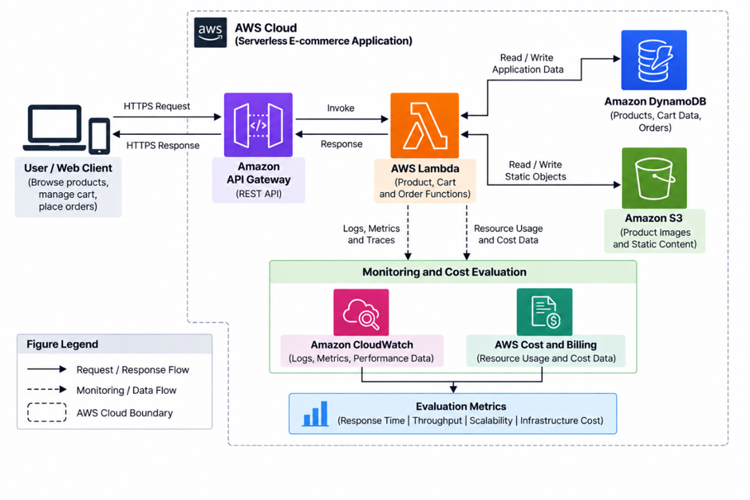
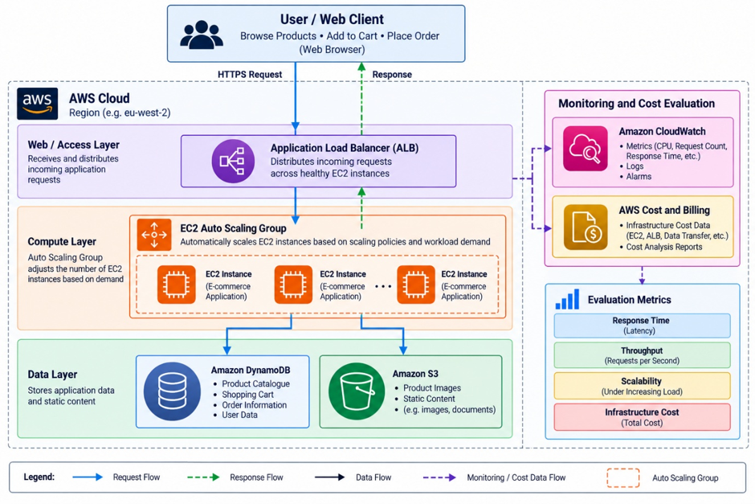

# E-Commerce Cloud Architecture: Serverless and EC2 Performance Evaluation

**MSc Computer Science Dissertation — York St John University, London Campus**

This repository contains the Terraform configuration, application code and load-testing scripts used to implement and evaluate two AWS e-commerce backends: a serverless architecture built with API Gateway and AWS Lambda, and a traditional baseline built with Amazon EC2, an Application Load Balancer and EC2 Auto Scaling.

The study examines how the two architectures handle increased request volumes, with particular attention to response time, throughput, scaling behaviour and infrastructure cost. The experimental deployment was carried out in **AWS Europe (London), `eu-west-2`**. Testing and infrastructure teardown were completed on **16 October 2026**.

## 1. System architecture

### Serverless backend



*Figure 1. Serverless application architecture.*

API Gateway forwards requests to three Lambda functions responsible for product retrieval, shopping-cart operations and order placement. DynamoDB stores the application data, while S3 holds static objects and product images. The deployed gateway was an **HTTP API**; the diagram's “REST API” label describes its request interface rather than the AWS API Gateway product type. The website itself was served through CloudFront with S3 as its origin, which is not depicted in Figure 1.

### Traditional EC2 backend



*Figure 2. EC2 Auto Scaling architecture used as the comparison baseline.*

The Application Load Balancer distributes API traffic to application instances in an EC2 Auto Scaling Group. The instances use the same DynamoDB tables and S3 storage as the serverless backend. Both architectures implement the same API operations so that comparable workloads can be applied to each. The traditional deployment serves as the experimental baseline, not as a separate proposed solution.

### AWS components

| Function | Serverless implementation | EC2 baseline |
|---|---|---|
| API entry point | API Gateway HTTP API | Application Load Balancer |
| Application compute | AWS Lambda | EC2 instances |
| Scaling | Lambda-managed concurrency | EC2 Auto Scaling Group |
| Data storage | DynamoDB and S3 | DynamoDB and S3 |
| Website delivery | CloudFront and S3 | CloudFront and S3 |
| Monitoring | CloudWatch and Locust | CloudWatch, EC2 Auto Scaling, ALB and Locust |
| Provisioning | Terraform | Terraform |

The application uses three DynamoDB tables: `Products`, `Carts` and `Orders`.

## 2. Application functionality

Both backends support the following routes:

| Method | Route | Operation |
|---|---|---|
| `GET` | `/products` | Retrieve the product catalogue |
| `POST` | `/cart` | Create or update cart data |
| `GET` | `/cart/{id}` | Retrieve a shopping cart |
| `POST` | `/orders` | Submit an order |

The project concentrates on the request-processing and scaling behaviour of these operations. Payment processing, customer accounts and production-grade authentication are outside the scope of the prototype.

## 3. Infrastructure configuration

Terraform manages the networking, permissions, application services, storage and load-balancing resources. The deployment used the following EC2 Auto Scaling settings:

| Setting | Value |
|---|---|
| EC2 instance type | `t3.micro` |
| Minimum instances | 1 |
| Initial desired instances | 1 |
| Maximum instances | 3 |
| Target CPU utilisation | 50% |
| Instance warm-up | 300 seconds |
| Application port | 8080 |
| ALB health-check path | `/health` |

The three Lambda functions were configured with **128 MB memory**. Cart and Order had a **30-second timeout**.

### Repository structure

```text
msc-ecommerce-terraform/
├── README.md
├── *.tf
├── ec2/
│   ├── app.py
│   └── user_data.sh
├── lambda/
│   ├── get_products/
│   ├── cart/
│   └── order/
├── frontend/
├── load-testing/
│   └── locustfile.py
└── docs/
    └── architecture/
        ├── serverless-architecture.png
        └── traditional-architecture.png
```

The root Terraform files are evaluated together. The `load-testing` directory also holds CSV exports generated during testing; these files are used for the detailed performance analysis.

## 4. Deployment and testing

The project requires Terraform, AWS CLI, Python, Locust and an AWS account with the necessary permissions. AWS credentials should be configured outside the repository.

From the project directory:

```bash
aws sts get-caller-identity
terraform init
terraform fmt -recursive
terraform validate
terraform plan
terraform apply
terraform output
```

Review the deployment plan before confirming `terraform apply`. The Terraform outputs provide the API Gateway endpoint, the ALB address and the CloudFront website URL. These addresses change when resources are recreated.

Locust was used to simulate product browsing, cart activity and order placement against each backend. A test can be started with:

```bash
locust -f load-testing/locustfile.py --host <TARGET_URL>
```

The experiments included a traditional-backend run with **400 concurrent users**. Client-side results were collected in Locust, while CloudWatch and the AWS service consoles provided information about compute activity, scaling and resource health. The final comparison of request counts, latency percentiles, throughput and failure rates is based on the saved Locust CSV files rather than estimates from screenshots.

## 5. Infrastructure observations

### Lambda activity

CloudWatch monitoring for a three-hour period on 16 October 2026 recorded:

| Function | Invocations | Average execution duration | Peak concurrency | Errors | Throttles |
|---|---:|---:|---:|---:|---:|
| Get Products | 66,393 | 125 ms | 59 | 0 | 0 |
| Cart | 132,622 | 98.49 ms | 72 | 0 | 0 |
| Order | 66,256 | 162 ms | 53 | 0 | 0 |
| **Total** | **265,271** | — | — | **0** | **0** |

These figures describe Lambda activity during the selected monitoring window. They are not a substitute for the end-to-end HTTP response times and failure rates recorded by Locust, and the window may include requests outside an individual test run.

### EC2 Auto Scaling

The EC2 Auto Scaling Group increased its desired capacity from **one instance to two** during the load test and later reduced it to **one**. AWS recorded scale-out at approximately **18:24 UTC** and scale-in at approximately **18:46 UTC** on 16 October 2026. The target group subsequently showed **one healthy target and no unhealthy targets**. These observations confirm that the CPU-based scaling policy was exercised under the tested workload.

### CloudFront and API monitoring

CloudFront monitoring recorded a small number of website requests and data transfers. This traffic is distinct from the direct API requests generated by Locust. The inspected API Gateway CloudWatch dashboard did not provide usable graphs for the selected period, so API request performance is assessed from the Locust results instead.

## 6. Cost analysis

AWS Cost Explorer was used to record account-level charges for the period **15–16 October 2026**. At the time of capture, the rounded dashboard showed approximately **US$0.40**, mainly attributed to Elastic Load Balancing, EC2 instances and VPC services. These figures are not an isolated cost total for either architecture; AWS billing can also be delayed.

The Lambda charge appeared as **US$0.00** in the displayed breakdown. This reflects the billed amount, not an absence of compute usage. Based on the observed invocation counts, mean execution durations and 128 MB memory allocation, the provisional Lambda request-and-compute cost at assumed standard rates, before free-tier allowances, was approximately **US$0.12**. The estimate excludes API Gateway, DynamoDB, S3, data transfer and other services. It should not be compared directly with the total account bill as though the two figures represented equivalent system costs.

The dissertation's cost evaluation distinguishes recorded AWS charges from usage-based estimates and considers the services included in each calculation.

## 7. Experimental scope and limitations

The comparison concerns two complete application deployments rather than a standalone benchmark of Lambda against a single EC2 instance. Both backends used the same logical data layer and equivalent API routes, but differed in compute provisioning, request routing and scaling mechanisms.

Results are specific to the application implementation, AWS Region, allocated resources, workload mix and test period. Lambda execution duration does not include all components of client-perceived latency. CloudWatch metrics and billing totals may also cover different time windows from individual Locust tests.

## 8. Infrastructure teardown

The deployed infrastructure was removed after testing on **16 October 2026**:

```bash
terraform destroy
```

Terraform reported:

```text
Destroy complete! Resources: 64 destroyed.
```

A subsequent `terraform state list` returned no resources. The Terraform-managed deployment is therefore no longer active. The application source code, configuration and locally saved test results remain available for analysis and future reproduction. This verification does not cover resources created outside Terraform, and AWS may report usage charges after the teardown date.

A future deployment should be reviewed carefully before use. Destroying the configuration removes its managed DynamoDB tables and S3 objects, so any required data should be exported beforehand.

## 9. Project context

This work forms part of an MSc Computer Science dissertation at **York St John University, London Campus**. The repository documents the implemented architectures and experimental environment; the dissertation contains the full research methodology, performance analysis and discussion of findings.
